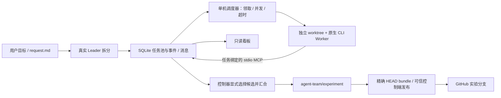

# Agent Team 软件工厂实验记录

本实验验证独立软件工厂的任务拆分、并发执行、消息交接与代码汇合。Model Relay 是实际任务载体，通用实现保存在本仓 `examples/agent-team-factory/`。不启动既有 Workflow、不合产品主线、不部署产品。

## 当前结论（实验仍在进行）

已观察到 **20 个真实 Native Worker 同时运行**：事件统计峰值20，20项任务各使用独立SID、分支和worktree。它们执行的是互不重复的静态产品代码审查，不能换算为20个功能、20个同时推理的模型请求或20倍交付效率；全部交接和汇合结果仍待核对。此前8项真实静态工程审查已经全部交接并合入实验分支。

三个真实代码候选已完成原样 `make verify`，第六轮批次1264.136秒，随后明确合入实验分支。每个候选均核对真实state回执、完整日志字节数与SHA-256、源及候选未变和进程组已退出；测试包含受控上游、全量race、前端及浏览器旅程。这仍不能代替独立业务合同验收：独立QA计划检查已发现原Leader要求精确大写Bearer及单SP的提案违反HTTP认证scheme大小写不敏感与RFC6750的`1*SP`规则。**自测全绿并没有证明需求判断正确。**

QA第一次独立计划评审结论为BLOCKED：SQLite TEMP trigger可能漏计时钟写入，最终恢复rename失败缺乏确定性验证入口，另有原始证据位置与测试路径冲突。计划v2已修订，真实Leader正在安排最小恢复测试设施、最终计划和独立复审；产品QA实操尚未开始，不能报产品通过。

当前维护源 `791c2456c236f9668600d2e032b80632d244630b`，经精确归档和SHA-256核对安装，**本机及实际执行主机完整37项源码隔离回归均通过**。新增仅限未启动任务的正式依赖修正及审计入口，已独立评审。20项静态审查此前误依赖产品QA门槛，已通过此入口纠正；这是实际规划/调度损耗，不能计入模型执行时间。

执行主机缺少GitHub写凭据，原push受控失败；未复制控制端凭据。维护源已实现精确HEAD的增量bundle导出和可信控制端发布器，包含不确定push回执、远端核对及非强制发布回归。真实远端成果发布仍待完成。当前实验汇合HEAD为 `ef379a26fbe7c6159134a01a6fb0164003c33ef8`，主线和部署未改变。

下文按实际轮次保留经过，不把早期失败抹去；历史段落中的“当前/尚未”仅指该轮次。

## 已确认的隔离与版本

| 项目 | 实际记录 |
|---|---|
| 跟踪 Issue | [Model Relay #74](https://github.com/big91987/model-relay/issues/74) |
| 源码分支 | `codex/agent-team-factory-experiment`，已创建并推送 |
| 首个原型提交 | `2425710bf0e2827e7c3ae8177cdad1de90d42476` |
| 测试仓汇合分支 | `agent-team/experiment`，已创建 |
| 测试仓初始基线 | `521751f1a0afaca26bd50b989f6f0df2d09f10e5` |
| 任务分支与工作区 | `agent-team/task-<id>-<attempt>` / `agent-team-worktrees/<id>-<attempt>` |
| 实验执行位置 | 独立 Linux 目录，使用用户已提供的 G112 入口；不改原平台服务 |
| 原生执行器 | 固定 Codex CLI 0.151.0；原有 ChatGPT 登录状态已核，不复制凭据 |
| 首轮配置 | 3 个执行位置；1800 秒单次原生执行上限 |

首个原型归档 25,148 bytes，SHA-256 `dbbf9568e7d86c34e8b40b65c19d12d16e43a44e0c2fdc509708c31a693b467a`。执行端核对后使用本维护源安装器部署到不可变 release 目录，Worker MCP 工具引用该精确版本。

## 验证分层与当前状态

| 层次 | 实际结果 | 不能据此声称 |
|---|---|---|
| 任务与进程隔离回归 | 最新本机和Linux执行机完整37项通过；保留早期红结果 | 真实模型并发或产品QA通过 |
| 静态检查 | Ruff、格式、页面脚本语法、gofmt 和 go vet 通过 | 整个既有平台完整回归通过 |
| 独立源码评审 | 四项 Important 与随后 stdin_closed 分支已修正并复验 | 原生恢复、20 并发或产品质量已验 |
| 真实 Leader | 真实拆分完成，60.708 秒，提出三项无依赖且修改路径分离的任务 | 任务提案正确或产品已交付 |
| 真实并发 Worker | 先后实测3、8、20个Native Worker峰值；20项静态审查仍在执行 | 20个功能并行交付、同时模型推理或20倍收益 |
| 独立产品复核与汇合 | 三个代码候选及8项工程审查已汇合；独立QA计划被实质阻断，待补设施复审 | 产品验收通过或已部署 |

`test_runner.py` 使用明确标识的临时协议探针，证实三个真实 OS 进程能够重叠、MCP 交接、受限提交和显式汇合。它没有调用模型，不能计入实际 Agent 吞吐。十九项包括真实 Git、Git hook、stdio MCP、进程背压/超时、原子领取和回环 HTTP；不属于 Model Relay 产品验收。

## 已发现的原型问题

1. **原生父进程退出后，后代持有 stdout 导致停止失效。** 改为终止本次创建的进程组，并限定读取清理时间。独立复验覆盖父进程已退出、子进程已启动的路径。
2. **同步输入写入绕过超时。** 改为非阻塞 stdin 与统一停止循环，提前关闭 stdin 也进入终止；生命周期状态和原始输出继续保存。
3. **集成冲突消耗后续排队任务。** 在领取之前核对实验 checkout，阻塞时保留 pending，不把未执行任务标失败。
4. **Git hook 扩大提交范围。** 对形成的实际提交再次检查相对基线的改动，越界候选保留但不接受为 ready。
5. **重复清理进程组可能丢失状态记录。** 避免已完成终止后的重复终止，异常终止保留证据并阻止继续派发。

这部分是维护源修复，不是在测试仓或运行副本中补丁。真实执行前通过精确源码安装。

## 环境与准备开销

- 本机直接 Git 克隆、HTTP/1.1 克隆与 GitHub 归档下载发生连接超时；GitHub API 仍可访问。连接器只有读取权限，写分支与 Issue 使用用户现有 gh 身份，未输出凭据。
- 本机原生只读 preflight 用时 118.029 秒，exit 1，模型请求超时；它不是 Worker 成功样本。
- 协调者最初漏用了用户已说明的 G112 入口，造成不必要等待；随后直接调用既有入口登录执行主机。这是实验准备与协调开销，不计入后续 Agent 净执行时间，也不从整体实验过程抹去。
- 执行主机使用已有代理完成 Git 克隆。核对后同一现有代理也恢复了本机 Git 传输，源码实验分支已正常推送。
- GitHub 精确基线 tree 中有 5,667 个 blob，共 501,556,294 bytes；`docs/workflow` 有 5,295 个 blob、497,993,864 bytes。历史证据占据大部分检出体积，普通多 worktree 会放大磁盘和准备开销。首轮使用标准 sparse checkout 保留项目源码和 Markdown；本次连接超时不能单独归因为仓库体积。

## 首轮 Leader 拆分

真实 Leader 已返回三项待执行任务：严格应用 Key 的认证格式、消除单请求重复推进有效时钟、严格恢复备份清单解析。它们分别修改认证、HTTP/时钟入口和备份模块，报告路径独立、无任务依赖。此处记录的是 Agent 的提案，不预先认定其业务判断或实现正确；实现后仍需独立复核合同、兼容边界和同版验证。

## 首轮真实执行：三并发成立，交接失败

三项任务启动时间分别为 Unix `1793501505.375823`、`1793501505.3882687`、`1793501505.400599`，各自获得不同原生会话与 `agent-team/task-*` 分支。它们实际执行了读代码、修改文件和测试工具调用，不能仅用进程创建推定业务完成。

三个原生回合均产生了源码和文档，但没有有效 handoff。原生回执明确返回 `MCP tool call requires approval, but approval policy is never`；控制器均保存为 failed，未接受候选、未提交产品代码。认证任务驻留约135.582秒，备份任务约70.479秒；完整时间、原生Token和工具记录留待同版汇总。

根因是 `codex exec` 非交互入口强制 Never，传入 on-request 配置不能提供交互审批。通用修正依据官方逐工具配置：默认仍 prompt，仅为绑定当前任务的本例 `get_task`、`send_message`、`handoff` 设置 approve，并明确 enabled_tools；不启用 auto_review、不批准 Shell 或其他 MCP。此为维护源的工具注册授权修复，原拒绝记录保留。后续只经正式 resume 入口继续原 SID 和原工作区，不补造旧 handoff。

Worker 同时报告 Go1.21低于项目1.25要求、原生沙箱禁止临时端口，以及 sparse checkout 缺失门禁引用的历史日志。仍需分别修正工程准备与受支持验证能力；不删除门禁、伪造基线或将专项通过冒充完整项目通过。

## 正式接续与第二轮结果

维护源 `0a9be1a17598c64acc64cfa85a2cddffdfb998de` 通过 SHA-256 校验安装到新 release，执行主机二十三项回归 exit 0。三个任务经正式 resume 接续原 SID、原 worktree；三次真实 MCP get_task/handoff 均已成功，第二轮批次用时约 21.022 秒。

| 任务 | 接续结果 | 真实验证限制 |
|---|---|---|
| strict-bearer-auth | ready，保存候选 `0cf1e2c62f2304572c0214417c28f442d468c3e4` | 专项通过，全量受 Go 版本和沙箱端口限制 |
| single-clock-advance | blocked，保留未提交修改 | 专项/race 通过，全量受版本、端口及基线缺失限制 |
| strict-backup-manifest | ready，保存候选 `e52dae6ed844cdbe95af28046836557dc4e3f9c3` | 格式检查通过，专项尚未编译，全量未通过 |

三个 Worker 对相似验证缺口给出不同完成状态，说明 ready 必须仅表示候选，不可视为验收或自动合并依据。独立复核仍须检查提案本身，例如 Bearer scheme 的大小写要求是否符合产品及协议约定，不能把 Leader 的提案直接当成正确合同。

环境准备已通过 Git 正式入口恢复四个实验 checkout 的完整跟踪基线，未合成缺失日志。Go1.25.6 工具链在执行主机已核对；原生沙箱的显式受限权限配置实测 exit0：回环监听成功、工作区内写入成功、区外写入被拒。该配置允许网络，不将其描述为仅回环白名单。

曾尝试固定命令的宿主验证 MCP 方案，独立评审指出项目代码仍获得宿主权限及后代清理竞态，已在发布前完整撤回，不进入安装版本。最终方向是在原生文件沙箱内执行项目门禁，通过正式配置入口固定非凭据环境和显式网络选择；未配置保持原默认，显式关闭不继承全局联网。候选复验继续使用正式 resume，保持原会话和候选 SHA。

## 第三轮与仓库准备修正

第三轮批次实际约206.764秒，三个Worker均blocked。Go1.25.6、Node22和原生沙箱回环端口已在真实执行中生效；时钟任务专项race 4.531秒、完整relay包62.972秒通过，备份专项1.781秒及CLI包4.764秒通过。原样make verify都在review-history因缺少历史Git对象提前结束，后续必跑阶段未执行。

这是首轮浅克隆带来的工程准备缺陷。已通过git fetch --unshallow补齐真实历史，并核对历史门禁引用的66f1328ada75ea90e5638fbf2bd58663ac86347e tree存在。安装说明改为完整克隆，不删除项目历史门禁。

第四轮正式resume尚未启动时，安全检查又暴露PID复用误阻：旧原生PID已被无关Linux内核线程复用，原独立进程组不存在。没有向该线程发信号，也没有改任务库。维护源改为核验本工具始终以start_new_session创建的原进程组；无关PID在其他组出现不代表旧原生会话仍存活，原组存在或无法核验仍拒绝。回归保留“父进程已退出但原组后代仍在时拒绝”，并增加复用PID不被误认的真实进程用例。

## 历史对象准备与第六轮

第四轮已从原三个会话启动，仍在历史归档失败。认证Worker获取了具体stderr：partial clone缺少promisor blob，原生沙箱中的共享Git对象目录只读，按需fetch不能创建tmp_pack。时钟与备份Worker仅凭commit/tree可见就归因于“隔离验证器传播缺陷”，其判断缺少底层stderr支持；这作为诊断质量差异保留。

准备真实review-history归档并通过原生沙箱临时目录/GIT_DIR/GIT_WORK_TREE探针后，第五轮实际review-history已通过；新首错推进至health-history另一历史基线。这纠正了前一轮的过度推断。第五轮批次88.240秒，仍是三个blocked，不能称完整产品通过。

随后从项目tests源码盘出3个显式历史Git引用：66f1328ada75ea90e5638fbf2bd58663ac86347e、85f6d17c07c5fddeb2d6a39a5a067769a11bb4cc、9b6994ed80de2bdba79ff267419150dccaac1360。已全部通过正式git archive准备真实对象，且在原生文件沙箱、私有临时目录及相同Git历史入口逐一archive exit0、stderr为空。第六轮据此正式接续原3个会话，完整make verify仍在执行。

最新执行维护源为b2bfdbdaa5caeb9952741038684a6502d873bb9f，归档29,686bytes、SHA-256 6712f195ed73c1f4813419c6e9b5182adb08d390974b7fa466e7c736291a2463；实际执行主机完整27项回归通过，PID修复已独立复核。没有在运行副本或产品源码补丁。

真实Leader另完成一次规划，提出QA合同复核与计划、独立READY评审、计划执行、独立Go/No-Go四项任务。它们通过依赖等待候选实际合入实验分支，尚未执行；不将计划产生记作QA通过。三项Worker并发上限3，规划Leader是另一个原生进程，整体资源评估须包含它，不能把Worker峰值当所有原生进程总峰值。

本机已用真实导出状态查看只读快照看板，实际渲染7项任务、团队原消息和执行记录，并验证任务展开。该快照不是第二个任务库或实时远程服务；正式运行状态仍在112的原库。看板Worker峰值取真实原生启动/结束事件，不再用领取峰值代替。

## 已显现的瓶颈（尚非最终效果结论）

- 工程准备占主要协调开销：不完整Git文件、浅历史、partial clone blob、工具链和测试网络连续阻断。新项目应按完整克隆及明确依赖/原生权限配置准备；本轮旧克隆通过Git正式入口补齐，既有失败不抹除。
- 项目门禁隐含历史Git依赖，且底层归档stderr被吞成exit128。建议由负责验证设施的Agent评估显式基线依赖与错误诊断；不能由Builder删门禁或替换历史。
- 三个任务反复执行相同历史重建，重复验证成本明显。后续评估按精确历史内容复用已验证结果及资源预算，不能在本轮擅自跳过断言。
- 候选完成状态、根因分析可信度与独立QA必须分开；本轮真实Agent有状态判断差异和不充分的设施归因。
- 截至只读快照的17条已结束原生turn回执，合计input_tokens 11,528,385、cached_input_tokens 11,099,904、output_tokens 54,870（含reasoning_output_tokens 7,844）。这是原始使用量累加，包含重复历史上下文与缓存，不能换算为净编码效率、账单或最终成本；第六轮及后续QA尚未计入。

## 调度压力与停止验证补充

维护源新增100项待办、20个领取位置、40个SQLite连接争用的隔离验证：首波20项保持running，最终按队列顺序排空、无重复领取，领取峰值20、原生进程峰值0。该证据仅证明任务库调度，不是20个真实Agent并发。完整本机30项维护源回归exit0；实际主机仍以已安装版本回执为准。

另经正式factory.py run入口验证SIGTERM时协议夹具的原生组和后代清理、interrupted状态保留；验证MCP额外身份字段、未注册工具、过期attempt不能修改任务或伪造消息。独立源码复核发现ps查询失败曾被测试当作清理成功，发布前已修正并以同一拒绝探针确认不再假绿；PID marker也改为原子发布。这些是工具隔离测试，不冒充真实模型取消或产品QA。

下一阶段已由真实Leader提出8项独立工程审查，分别覆盖知识合同、代码边界、可复现环境、验证证据、CI发布、测试体系、运行恢复、交付追溯，全部等待原3项候选汇合。明确其是静态工程工作，不称8个功能交付，不代产品实操QA；随后才依据真实队列与证据评估更高并发。

## 明确未完成

- 三个原始候选的完整门禁已通过并汇合；独立产品QA尚未执行，原认证提案存在已识别的合同错误。
- 已实际达到20个Native Worker峰值，仍须核对全部20项的交接、失败和汇合；不做功能吞吐或生产容量结论。
- 崩溃后不确定进程核验与冲突解决入口仍未完成。
- 自动事件唤醒 Leader、持续协调与项目级完整闭环；当前原型是正式 CLI 驱动的批次。
- 最终实验分支汇合、对外可看的完整结果报告。

后续按实际回执更新，不将计划写成结果。

## 分层改进建议（由本轮证据驱动）

| 归属 | 优先问题 | 本轮事实及建议 |
|---|---|---|
| 需求与流程 | 提案正确性 | Leader把“严格”误写成大小写/单SP强制，开发回归自洽却违反协议。任务进入实现前，明确正式合同/标准来源和负例；独立检查不能只对原提案打勾。 |
| 测试仓工程设施 | 可复现准备 | 工具链、网络和历史Git依赖反复阻塞。新仓按固定版本做真实preflight、显式声明历史基线，保留底层stderr；不靠协调者多轮救援。 |
| 测试仓验证 | 验证成本与信噪比 | 三个小改动各做约20.5分钟完整门禁，包含重复历史重建与浏览器。后续区分快速开发反馈和精确最终候选全量验收，能复用的不可变历史证据单独版本化；本轮没有跳过原门禁。 |
| 工厂调度 | 门槛与任务完成分开 | 完成一份BLOCKED评审也是工作完成，但不能放行产品实操。当前需协调者核验结论；后续沉淀可信评审结果与释放条件，避免仅依据文档任务merged。 |
| 工厂调度 | 减少批次等待 | run持有批次控制器锁，单个Worker完成仍要等整批才能汇合、释放依赖。应把领取、独立候选汇合、事件唤醒分别控制，明确Git写互斥和候选版本。 |
| 工厂交付 | 可信发布边界 | 执行机无写凭据的失败已记录。使用控制端精确版本bundle发布，保留未知副作用和远端回执；禁止为了通过而复制令牌给Worker。 |
| 仓库入口 | 任务路由 | 实验跟踪Issue及新评论仍触发旧入口Actions，均在连接旧平台前失败。后续明确opt-in路由及实验类别；本轮未改主线workflow或启动旧平台服务。 |
| 可观测性与度量 | 真实分母 | 区分需求、实现任务、静态审查、QA、重试与排队；记录端到端时间、有效完成、返工、独立缺陷和成本回执。没有人工基线，不把PR/任务数当效率提升。 |

成熟度判断：任务库、真实原生交接、显式恢复、隔离worktree和受限汇合已获得实证；持续自主协调、多租户隔离、质量门禁语义、异常恢复和面向用户的端到端入口仍不具备生产软件工厂水平。Model Relay已有较丰富的自动化与运营约束，但规范正确性、模块边界、证据仓储及开发反馈成本仍需要治理；静态审查指出的风险必须与已复现缺陷分开。

## 20并发首轮实测与发布

20项独立静态代码审查的原生会话启动跨度为1793509458.2377396至首轮全部原生结束1793509649.3240976，共191.086秒，中位驻留115.541秒。Worker原生进程峰值20；同时另有规划Leader，因此全部原生进程峰值21。首轮17/20有效handoff，3项exit0但无handoff被正式标failed，不凭报告存在补造交接。该批次后来还动态领取了恢复测试设施，整个run233.354秒不能当作纯20项审查耗时。

三项失败会话均自报任务工具未暴露；启动参数均包含相同MCP配置，现有stderr不足以确认具体原因。维护源增加必需MCP和30秒启动等待，并要求先成功get_task；实际固定CLI的断开服务器探针在1.567秒exit1、没有turn.started。第一次探针因Git仓库检查提前退出，未验证MCP，原回执保留；第二次才证明上述结论。

按正式入口原SID/worktree接续后，两项获得真实handoff并汇合，一项再次自报get_task未暴露，按新指令立即停止、没有改文件，仍failed。本轮审查累计19/20有效交付；不声称工具可用性问题根治，不盲重试或把这项未验内容合入。

恢复工程设施由真实Worker交付，发现已存在目标在最终rename失败后被删除，确定性回归为红，正常入口和absent子例通过。该红结果保留在实验分支，未修改恢复算法掩盖缺陷；独立QA继续依据最终计划判断。

可信控制端已通过正式发布器将精确HEAD `aade8d2f72d42ca66349d6127cfd78a3a012b1cf` 发布至[Model Relay实验分支](https://github.com/big91987/model-relay/tree/agent-team/experiment)，远端读回同SHA。增量bundle 227,746bytes，SHA-256 `61cfaf6927246f842a39b0aadb837533ae98a6118742ad2fb8402b62f76e2502`；没有复制控制端凭据到112，没有强推或修改主线。后续QA材料还有待再次汇合/发布。

一次性大状态导出曾阻塞G112终端观测。已恢复流控并自行经G112建立另一专属控制连接；Worker未重启、未知操作未重放。后续产物分块传输并校验摘要。此处暴露的是控制/证据传输设施短板，正式产品应提供有边界的状态和产物接口，不能长期依赖终端搬运。

## 原型架构与本轮边界

同一台执行机的Python线程池负责等待不同原生进程，推理由各原生会话执行；SQLite事务原子领取，Worker通过MCP写持久化交接，不以终端文本或进程退出码模拟完成。Git worktree共享仓库对象、隔离检出和分支。一次任务可正式接续原SID与工作树，原始每轮输出独立保留；未知副作用不自动重放。

当前仍由协调者通过正式CLI发起批次、检查评审结论并选择实验汇合，Leader没有常驻事件唤醒，也没有面向多个业务需求的完整受理/运营界面。该原型证明执行、交接与实验汇合链路，不等于无人值守的软件工厂。还没有多机分布式调度、租户级容器隔离、资源配额或生产SLA；原生文件沙箱与独立worktree不是多租户容器隔离。SQLite在本轮有20进程及100项领取回归证据，但没有据此得出高并发生产容量结论。

持久化、并发生命周期、原生SID接续、任务绑定工具与候选追溯可作为通用平台能力；业务需求池、质量门槛裁决、集成政策和运营指标应属于软件工厂应用层。当前不急于把上层业务对象塞进既有通用工作流，先根据本轮失败与人工协调记录确定边界。

未解决的原生工具可用性与恢复问题已进入唯一维护源[Agent Platform #7](https://github.com/big91987/agent_platform/issues/7)。required加固及实际反例均关联，不将其关闭或宣称已根治。

## 交付内容与私有候选历史隔离

时钟持久化设施已由真实Worker完成开发自测：连接级SQLite commit hook触发真实commit-only错误，begin/read/update/commit命中可独立核验，正常委托及定向设施自测通过；完整relay包仍因已知Restore existing-target红断言失败。设施不是最终产品QA，实操仍等待v4计划/独立READY。

发布检查在设施文档发现执行机私有路径，原Worker已通过正式同SID/worktree接续清理，保留先前原始回执、失败次数和私有候选。普通merge即使最终文档干净，也会让清理前父提交变为公开可达；维护源因此统一改为squash最终内容，不改写既有已发布历史。新公开版本以integration_commit为准，私有candidate SHA不再是公共HEAD的祖先要求。

独立真实Git红回归证明旧入口会导出私有commit和blob。源码评审又分别复现post-commit改HEAD、post-merge改index树导致的完整性缺口；最终修复是在merge hook前独立merge-tree计算预期树，提交后核分支、干净状态、实际树和唯一公开父，失败保留pending记录并阻止后续派发、汇合、导出，不自动撤销Git或重放。hooks仍执行，不把结果完整性检查当成对任意恶意hook的宿主隔离。

本机完整41项回归通过，独立评审原两项hook复现均被拒绝、pending保留且bundle受阻；正常导出明确核对私有commit及blob不可达、私有候选原历史仍在，空变化与冲突保留通过。执行端实际Git2.55.0、控制端2.50.1，安装要求Git2.38+；新版本执行端安装和实际干净设施汇合将单独核对，不把隔离回归写成产品验收。
